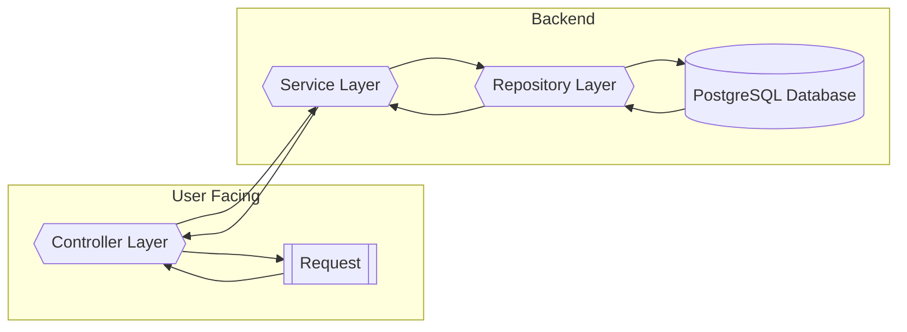
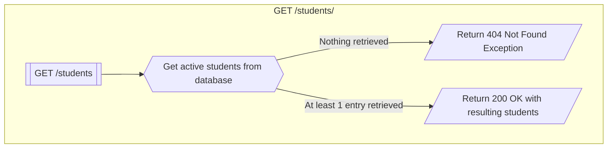
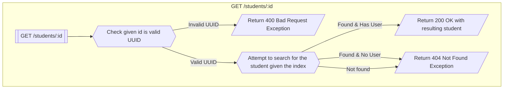
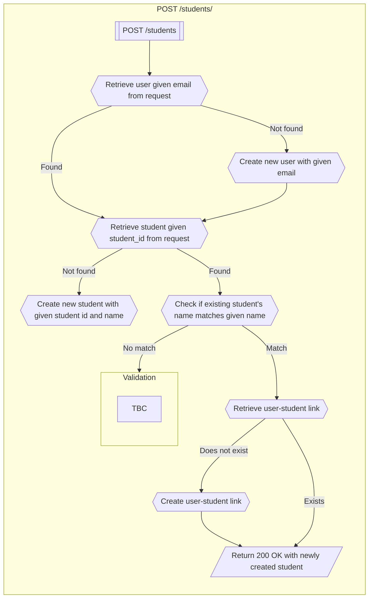
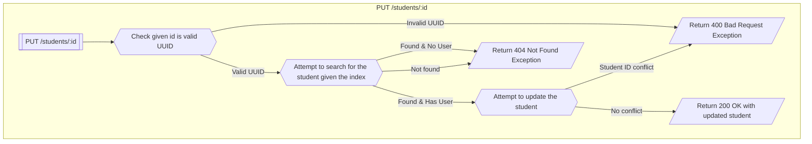

# API Flow Reference

When an API endpoint is called, the general flow looks like:

## Core design decisions

- Returning `404 Not Found` when an invalid UUID is given as a path parameter

## Students endpoint

### Entities

1. Student (Full) \[Return value object only]
   1. `id` — student UUID
   2. `email` — user email associated with student
   3. `name` — student’s name
   4. `studentId` (aliased to `student_id` in requests/responses) — student’s
      assigned id
2. Student (Create)
   1. `email` — user email associated with student
   2. `name` — student’s name
   3. `studentId` (aliased to `student_id` in requests/responses) — student’s
      assigned id
3. Student (Update)
   1. `name` — student’s name
   2. `studentId` (aliased to `student_id` in requests/responses) — student’s
      assigned id

### `GET /students/`

Returns all existing students in the system (excluding those that have already
been deactivated).

Returns a JSON array of Student (Full) entities.

### `GET /students/:id`

Returns the matching student given the student UUID associated with the student.

Returns a Student (Full) entity.

### `POST /students/`

Creates new student records given a JSON array of Student (Create) entities.

The flowchart will attempt to run sequentially in a transaction block so
everything rolls back if there are errors.

The core idea is that when creating a new batch of students, if a student
already exists within the system, their core particulars cannot be changed. If
any changes are detected, the entire batch of students will not be created and
will instead be validated for further errors.

### `PUT /students/:id`

Updates a given student record that matches the given student UUID.

